# 光学谐振腔自再现模式的仿真计算报告

作者：彭友  
班级：光电2404班  
学号：U202413812  
题目：光学谐振腔自再现模式的仿真计算

> 阅读报告之前请先阅读README。项目结构，启动方式，文件分布和内容都在README中，再有问题请拉issue或者联系作者。

## 建模
### 问题分析
这个题目是根据激光原理第九讲和第八讲的fox-li迭代法来完成自在现模的验证和仿真，与PPT不同的是，题目要求的对称共焦腔，而PPT上的公式是平面腔。根据文献H. Kogelnik、T. Li，Laser Beams and Resonators，Applied Optics，1966[1]，我们需要考虑反射镜的曲率半径，在1D和2D和倾斜情况下，虽然只是一点点距离，但是对于激光的波长来说，也会给相位带来很大影响。综上，相关公式得重新推导
### 符号定义
| 符号 | 含义 | 单位或约定 |
|---|---|---|
| $u(x,y)$ | 指定横截面上的标量复振幅 | $|u|$ 为振幅，$\arg u$ 为相位 |
| $\lambda$ | 腔内介质中的波长 | m；本项目按自由空间处理 |
| $k=2\pi/\lambda$ | 波数 | rad/m |
| $L$ | 两面镜子顶点参考平面之间的距离 | m，$L>0$ |
| $(x',y')$ | 出发面上的积分坐标 | m |
| $(x,y)$ | 到达面上的观察坐标 | m |
| $\rho$ | 出发点到观察点的实际直线距离 | m |
| $R_j$ | 第 $j$ 面镜子的曲率半径 | 从腔内看为凹面时 $R_j>0$ |
| $a,b$ | 矩形孔径沿两个方向的半宽 | m |
| $A_j(x,y)$ | 第 $j$ 面镜子的孔径函数 | 孔径内为 1，孔径外为 0 |
| $\mathcal P_L$ | 连续 Fresnel 传播算子 | 自由空间传播距离 $L$ |
| $\mathcal M_j$ | 镜面反射算子 | 包含孔径与曲率相位 |
| $\gamma$ | 完整往返的本征值 | 无量纲复数 |

### 假设
1. 实际随时间振荡的光场，采用以下约定：

$$
E_{\mathrm{phys}}(x,y,z,t)
=\operatorname{Re}\!\left\{u(x,y,z)e^{-i\omega t}\right\}.
$$

2. 镜面的反射系数为1
3. 虽然是球面反射，但是反射角度很小，距离还是视为L，但是相位得重新计算

### 从菲涅尔–基尔霍夫衍射积分得到 Fresnel 积分

下面沿用课程课件中从衍射积分到傍轴传播的思路，按本文的 $e^{-i\omega t}$ 时间约定展开推导。在正入射、标量 Kirchhoff 近似下，可以把熟悉的衍射积分写成：

$$
u(P)\simeq
\frac{1}{i\lambda}
\iint_S
u(Q)\,\frac{e^{ik\rho}}{\rho}\,
B(\theta)\,\mathrm dS',
\qquad
B(\theta)=\frac{1+\cos\theta}{2}.
\qquad \text{(1)}
$$

把出发面放在 $z=0$，到达面放在 $z=L$。取：

$$
Q=(x',y',0),\qquad P=(x,y,L).
$$

从 $Q$ 指向 $P$ 的位移向量是：

$$
\overrightarrow{QP}=(x-x',\,y-y',\,L).
$$

根据三维勾股定理：

$$
\rho^2=(x-x')^2+(y-y')^2+L^2.
$$

取正的距离：

$$
\rho=\sqrt{L^2+(x-x')^2+(y-y')^2}.
\qquad \text{(2)}
$$

在平面 $z=0$ 上，面积元就是：

$$
\mathrm dS'=\mathrm dx'\,\mathrm dy'.
\qquad \text{(3)}
$$

式（3）是平面坐标下的面积元表达，但是无法在电脑中运行，需要离散化，离散化在后文

定义：

$$
s^2=(x-x')^2+(y-y')^2,\qquad
\eta=\frac{s^2}{L^2}.
\qquad \text{(4)}
$$

其中 $s$ 是两个点之间的横向距离，$\eta$ 是无量纲小量。由几何关系：

$$
\tan\theta=\frac{s}{L},\qquad
\cos\theta=\frac{L}{\rho}.
$$

近轴传播要求 $s/L\ll1$，也就是 $\eta\ll1$。

由式（2）：

$$
\rho=L\sqrt{1+\eta}.
$$

所以：

$$
\frac{1}{\rho}
=\frac{1}{L}(1+\eta)^{-1/2}.
$$

利用小量展开：

$$
(1+\eta)^{-1/2}
=1-\frac{\eta}{2}+\frac{3\eta^2}{8}+\cdots,
$$

得到：

$$
\frac{1}{\rho}
=\frac{1}{L}
\left(1-\frac{\eta}{2}+\cdots\right)
\simeq\frac{1}{L}.
\qquad \text{(5)}
$$

这里丢掉的是相对大小为 $\eta$ 量级的振幅修正。

同样：

$$
\cos\theta=\frac{L}{\rho}
=(1+\eta)^{-1/2}
\simeq1-\frac{\eta}{2},
$$

于是：

$$
B(\theta)=\frac{1+\cos\theta}{2}
\simeq1-\frac{\eta}{4}
\simeq1.
\qquad \text{(6)}
$$

将式（3）、（5）、（6）代入式（1）：

$$
u(x,y;L)\simeq
\frac{1}{i\lambda L}
\iint_S
u(x',y';0)\,e^{ik\rho}
\,\mathrm dx'\,\mathrm dy'.
\qquad \text{(7)}
$$

**此时只近似了振幅系数，指数中的 $\rho$ 还没有近似成 $L$。**

如果直接令 $e^{ik\rho}\approx e^{ikL}$，所有出发点到同一观察点的传播相位就相同了。这样会丢掉横向干涉所需要的光程差，不能正确描述衍射。

光程改变 $\Delta\rho$ 引起：

$$
\Delta\phi=k\Delta\rho
=\frac{2\pi}{\lambda}\Delta\rho.
\qquad \text{(8)}
$$

$\Delta\rho$ 与厘米量级的腔长相比可能很小，但与微米量级的波长相比可能很大。所以“对总距离很小”并不代表“对相位很小”。

令：

$$
f(\eta)=\sqrt{1+\eta}=(1+\eta)^{1/2}.
$$

先计算函数及导数在零点的值：

$$
f(0)=1,
$$

$$
f'(\eta)=\frac12(1+\eta)^{-1/2},
\qquad f'(0)=\frac12,
$$

$$
f''(\eta)=-\frac14(1+\eta)^{-3/2},
\qquad f''(0)=-\frac14.
$$

Taylor 公式的二阶项还要除以 $2!=2$：

$$
f(\eta)
=f(0)+f'(0)\eta+\frac{f''(0)}{2!}\eta^2+\cdots
=1+\frac{\eta}{2}-\frac{\eta^2}{8}+\cdots.
$$

两边乘 $L$：

$$
\rho
=L\left(1+\frac{\eta}{2}-\frac{\eta^2}{8}+\cdots\right).
$$

再代入 $\eta=s^2/L^2$：

$$
\rho
=L+\frac{s^2}{2L}-\frac{s^4}{8L^3}
+\mathcal O\!\left(\frac{s^6}{L^5}\right).
\qquad \text{(9)}
$$

Fresnel 近似保留到横向坐标的二次项：

$$
\boxed{
\rho\simeq
L+\frac{(x-x')^2+(y-y')^2}{2L}.
}
\qquad \text{(10)}
$$

分母的 $2$ 来自 $f'(0)=1/2$，不是人为添加的常数。

若出发点和观察点都限制在 $[-a,a]\times[-b,b]$，则：

$$
|x-x'|\le2a,\qquad |y-y'|\le2b,
$$

所以：

$$
s_{\max}^2\le4(a^2+b^2).
$$

从式（10）：

$$
ik\rho\simeq
ikL+\frac{ik}{2L}
\left[(x-x')^2+(y-y')^2\right].
$$

$$
e^{ik\rho}\simeq
e^{ikL}
\exp\!\left\{
\frac{ik}{2L}
\left[(x-x')^2+(y-y')^2\right]
\right\}.
\qquad \text{(11)}
$$

$e^{ikL}$ 与积分坐标无关，可以移到积分号外。由式（7）得到：

$$
\boxed{
u(x,y;L)=
\frac{e^{ikL}}{i\lambda L}
\iint_S u(x',y';0)
\exp\!\left\{
\frac{ik}{2L}
\left[(x-x')^2+(y-y')^2\right]
\right\}
\,\mathrm dx'\,\mathrm dy'.
}
\qquad \text{(12)}
$$

式（12）是在 Fresnel 模型内采用的传播方程；与更一般的衍射积分比较时仍是近似式。

### 由球面方程逐步求球面导致的相位差
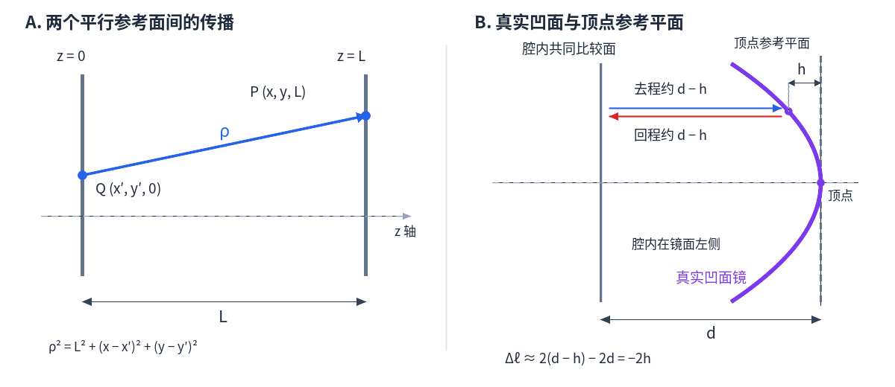

**图 1：** 左图表示两个平面间的传播距离 $\rho$；右图表示凹面镜相对顶点参考平面的正矢高 $h$。右图箭头用于近轴光程比较，不是精确的离轴反射光线。

定义离轴距离：

$$
r_\perp=\sqrt{x^2+y^2}.
$$

为避免与传播距离 $\rho$ 混淆，这里用 $r_\perp$ 表示横向半径。

从球心、顶点与离轴点构成的直角三角形：

$$
r_\perp^2+(R-h)^2=R^2.
$$

移项：

$$
(R-h)^2=R^2-r_\perp^2.
$$

取顶点附近的正根：

$$
R-h=\sqrt{R^2-r_\perp^2}.
$$

因此精确的球面矢高为：

$$
h=R-\sqrt{R^2-r_\perp^2}
=R\left[1-\sqrt{1-\frac{r_\perp^2}{R^2}}\right].
\qquad \text{(25)}
$$

令 $v=r_\perp^2/R^2$。使用第一节的根号展开，把小量换成 $-v$：

$$
\sqrt{1-v}=1-\frac v2-\frac{v^2}{8}+\cdots.
$$

于是：

$$
\begin{aligned}
h
&=R\left[1-\left(1-\frac v2-\frac{v^2}{8}+\cdots\right)\right]\\
&=R\left(\frac v2+\frac{v^2}{8}+\cdots\right)\\
&=\frac{r_\perp^2}{2R}
+\frac{r_\perp^4}{8R^3}+\cdots.
\end{aligned}
$$

在近轴球面近似下：

$$
\boxed{h(x,y)\simeq\frac{x^2+y^2}{2R}.}
\qquad \text{(26)}
$$

这里同样保留了横向坐标的二次项。

对假想平面镜：

$$
\ell_{\mathrm{flat}}=d+d=2d.
$$

对向腔内突出 $h$ 的真实镜面，在近轴光程比较下：

$$
\ell_{\mathrm{concave}}\simeq(d-h)+(d-h)=2d-2h.
$$

真实光程减去参考光程：

$$
\begin{aligned}
\Delta\ell
&=\ell_{\mathrm{concave}}-\ell_{\mathrm{flat}}\\
&=(2d-2h)-2d\\
&=-2h.
\end{aligned}
\qquad \text{(27)}
$$

这里用近轴轴向路程来说明参考面模型。一般斜入射时，镜面法向位移对应的反射相位修正还包含入射角的投影因素；本文保留的阶次取 $\cos\alpha\approx1$，并不把图中的两条平行箭头当成真实反射光线。

按本文传播相位 $e^{+ik\ell}$，反射前后相对参考平面镜的相位因子为：

$$
\frac{e^{ik\ell_{\mathrm{concave}}}}
{e^{ik\ell_{\mathrm{flat}}}}
=e^{ik(\ell_{\mathrm{concave}}-\ell_{\mathrm{flat}})}
=e^{-i2kh}.
$$

由式（26）：

$$
-2kh\simeq
-2k\frac{x^2+y^2}{2R}
=-\frac{k(x^2+y^2)}{R}.
$$

所以：

$$
\boxed{
m_R(x,y)=
\exp\!\left[-\frac{ik(x^2+y^2)}{R}\right].
}
\qquad \text{(28)}
$$

令孔径内反射率为 1，把有限镜面大小也写进去：

$$
\boxed{
(\mathcal M_j u)(x,y)=
A_j(x,y)
\exp\!\left[-\frac{ik(x^2+y^2)}{R_j}\right]
u(x,y).
}
\qquad \text{(29)}
$$

本文省略了位置无关的反射相位常数；若实际反射系数有共同相位，可额外乘进 $\mathcal M_j$，它会改变往返本征值的整体相位约定。

对于矩形孔径：

$$
A_j(x,y)=
\begin{cases}
1,& |x|\le a_j,\ |y|\le b_j,\\
0,& \text{其他位置}.
\end{cases}
\qquad \text{(30)}
$$

曲率因子模长为 1，所以镜面曲率本身只改变相位；孔径截断会去掉部分场。曲率会进一步影响传播后的光场分布，因而也能间接改变有限孔径下的损耗。

## 离散形式的 Fox–Li 迭代与 FFT 加速
因为在电脑上面计算，不能使用连续的进行计算，得奖球面进行切割离散化，但是离散化之后二维的计算复杂度太大，根据M. M. Johnson, “Direct Application of the Fast Fourier Transform to Open Resonator Calculations,” Applied Optics, 13(10), 2326 (1974)文献[2]，我们可以采用FFT对这个计算进行加速

### 1. 选取网格，把传播积分变成求和

取计算窗口 $[-X,X)\times[-Y,Y)$，沿两个方向分别取 $N_x,N_y$ 个点：

$$
\Delta x=\frac{2X}{N_x},\qquad
\Delta y=\frac{2Y}{N_y},
$$

$$
x_p=-X+p\Delta x,\qquad y_q=-Y+q\Delta y.
$$

其中 $p=0,\ldots,N_x-1$，$q=0,\ldots,N_y-1$。用数组 $U[q,p]=u(x_p,y_q)$ 保存复场，行对应 $y$，列对应 $x$。

每个网格单元面积为 $\Delta A=\Delta x\Delta y$。将积分近似成“采样值乘面积再求和”，前文的 Fresnel 传播得到：

$$
\boxed{
V[\ell,j]\approx
C_L\Delta A
\sum_{q=0}^{N_y-1}\sum_{p=0}^{N_x-1}
U[q,p]\,
e^{ik[(x_j-x_p)^2+(y_\ell-y_q)^2]/(2L)},
\quad
C_L=\frac{e^{ikL}}{i\lambda L}.
}
\qquad \text{(4-1)}
$$

这是直接离散求和。$\Delta A$ 来自面积元，不能漏掉。镜面则只需逐点乘：

$$
M_j[q,p]=A_j(x_p,y_q)e^{-ik(x_p^2+y_q^2)/R_j}.
\qquad \text{(4-2)}
$$

一维情况下，二重求和改为一重求和，面积改为 $\Delta x$，传播系数改为：

$$
V[j]\approx
\frac{e^{ikL}}{\sqrt{i\lambda L}}\Delta x
\sum_p U[p]e^{ik(x_j-x_p)^2/(2L)}.
\qquad \text{(4-3)}
$$

网格只是在平面上采样，球面作用已包含在镜面相位中，不再对真实球面重复计算光程。

### 2. 先把 Fresnel 传播写成卷积

Fresnel 核只依赖出发点与到达点的位置差。定义：

$$
h_L(x,y)=C_Le^{ik(x^2+y^2)/(2L)},
$$

则连续传播可以写成卷积：

$$
v(x,y)=\iint u(x',y')h_L(x-x',y-y')
\,\mathrm dx'\,\mathrm dy'
=(u*h_L)(x,y).
$$

Fourier 变换把卷积变成乘法：

$$
\widehat v(f_x,f_y)
=H_L(f_x,f_y)\widehat u(f_x,f_y),
\qquad H_L=\mathcal F\{h_L\}.
\qquad \text{(4-4)}
$$

因此，FFT 加速要做的就是：**变换到频域，逐点乘传播传递函数，再逆变换回空间。**

#### 再求出频域传递函数

采用 Fourier 变换约定：

$$
\widehat u(f_x,f_y)=
\iint u(x,y)e^{-i2\pi(f_xx+f_yy)}
\,\mathrm dx\,\mathrm dy.
$$

$f_x,f_y$ 为横向空间频率，单位 $\mathrm m^{-1}$。由于 $k/(2L)=\pi/(\lambda L)$，两个方向的积分可以分开：

$$
H_L(f_x,f_y)
=\frac{e^{ikL}}{i\lambda L}J(f_x)J(f_y),
$$

$$
J(f)=\int_{-\infty}^{\infty}
e^{i\pi t^2/(\lambda L)-i2\pi ft}\,\mathrm dt.
$$

对指数配方：

$$
\frac{i\pi t^2}{\lambda L}-i2\pi ft
=\frac{i\pi}{\lambda L}(t-\lambda Lf)^2
-i\pi\lambda Lf^2.
$$

平移积分变量，使用振荡 Gaussian 积分：

$$
\int_{-\infty}^{\infty}e^{i\pi s^2/(\lambda L)}\,\mathrm ds
=\sqrt{i\lambda L},
$$

得到：

$$
J(f)=\sqrt{i\lambda L}\,e^{-i\pi\lambda Lf^2}.
$$

上述振荡积分按加入小衰减因子后取极限理解。两个方向相乘，$\sqrt{i\lambda L}$ 的乘积与分母约掉：

$$
\boxed{
H_L(f_x,f_y)=
e^{ikL}e^{-i\pi\lambda L(f_x^2+f_y^2)}.
}
\qquad \text{(4-5)}
$$

所以**空间核的二次相位是正号，频域传递函数的二次相位是负号**，二者是 Fourier 变换关系。

一维只去掉 $f_y^2$：

$$
H_L^{(1)}(f_x)=e^{ikL}e^{-i\pi\lambda Lf_x^2}.
$$

这里空间积分的传播系数已经参与变换，不需要在 FFT 输出上再乘 $C_L$。

### 3. 把连续 Fourier 变换变成离散 Fourier 变换

#### 先确定空间频率网格

频率间距由空间间距与点数共同确定：

$$
\Delta f_x=\frac{1}{N_x\Delta x},\qquad
\Delta f_y=\frac{1}{N_y\Delta y}.
\qquad \text{(4-6)}
$$

对当前采用的偶数点数，零频放在数组中心时：

$$
f_{x,a}^{\,c}=\frac{a-N_x/2}{N_x\Delta x},
\qquad
f_{y,b}^{\,c}=\frac{b-N_y/2}{N_y\Delta y}.
$$

NumPy 用 <code>fftfreq</code> 生成频率，再用 <code>fftshift</code> 将零频移到中心。不要把所有频率下标都当成正频率。

#### DFT 是求和，FFT 是快速计算这一求和的方法

先按未移位顺序写出二维 DFT：

$$
\widehat U[b,a]=
\sum_{q,p}U[q,p]e^{-i2\pi(ap/N_x+bq/N_y)},
$$

$$
U[q,p]=\frac{1}{N_xN_y}
\sum_{b,a}\widehat U[b,a]e^{i2\pi(ap/N_x+bq/N_y)}.
\qquad \text{(4-7)}
$$

FFT 计算的就是这个 DFT，没有改变传播物理。采用匹配的频率排序，在各频率点计算：

$$
H[b,a]=e^{ikL}
e^{-i\pi\lambda L(f_{x,a}^2+f_{y,b}^2)}.
$$

然后：

$$
\boxed{
V=\operatorname{IFFT2}
\left[H\odot\operatorname{FFT2}(U)\right].
}
\qquad \text{(4-8)}
$$

$\odot$ 表示对应元素相乘，不是矩阵乘法。一维将 FFT2、IFFT2 换成 FFT、IFFT。

#### FFT 加速复杂度

FFT 将一维 DFT 递归拆成较短的 DFT，共享中间结果，每层约 $\mathcal O(N)$、共约 $\log N$ 层，所以一维为 $\mathcal O(N\log N)$。二维沿行、列分别计算，若每轴有 $N$ 点，则：

| 单程方法 | 二维计算量 |
|---|---|
| 逐输出直接双求和 | $\mathcal O(N^4)$ |
| 可分离核的矩阵乘法（项目的小网格校验） | $\mathcal O(N^3)$ |
| FFT 传递函数法 | $\mathcal O(N^2\log N)$ |

### 4.用 FFT 完成一次 Fox–Li 往返

记 $\mathsf P=\mathsf P_{\mathrm{FFT}}$。输入 $U_n$ 记录在 M1 反射后；按照课程中的往返自再现思路，一次往返依次是 M1 到 M2、M2 反射、返回 M1、M1 反射：

$$
V_n=\mathsf P(U_n),\qquad
W_n=M_2\odot V_n,
$$

$$
Z_n=\mathsf P(W_n),\qquad
\widetilde U_{n+1}=M_1\odot Z_n.
$$

合并为：

$$
\boxed{
\widetilde U_{n+1}
=M_1\odot\mathsf P
\left[M_2\odot\mathsf P(U_n)\right].
}
\qquad \text{(4-12)}
$$

两程均沿实际光行进方向传播正距离 $L$，回程不改用逆传播。镜面相位和孔径必须在空间域施加，不能把两次频域 $H$ 直接平方代替完整往返。

为避免场整体衰减影响形状比较，程序每轮按数组范数归一化：

$$
U_{n+1}
=\frac{\widetilde U_{n+1}}
{\sqrt{\sum_{q,p}|\widetilde U_{n+1}[q,p]|^2}}.
\qquad \text{(4-13)}
$$

零输出不能归一化。归一化只改变整体尺度，不改变场形状；它不表示实际光功率为 1。镜面与往返由 [cavity.py](src/Python/cavity.py) 实现，迭代由 [fox_li.py](src/Python/fox_li.py) 执行。

## 收敛标准

归一化后的 Fox–Li 迭代可以看作求往返算子本征模式的幂法。本文参考相邻归一化迭代向量差的收敛判断方法[3]，先消除复光场的整体相位，再结合光强和本征值的变化判断收敛。

Fox–Li 迭代的目标不是让场的数值逐点保持完全不变，而是找到往返传播算子的自再现模式。设一次完整往返（包括两次传播和两面镜面作用）为算子 $T$，则自再现模式满足

$$
T[U]=\gamma U,
$$

其中 $\gamma$ 是往返本征值。$\gamma$ 一般是复数：它的模 $|\gamma|$ 表示往返后的振幅保留程度，辐角表示往返产生的整体相位。程序每轮将场归一化，因此比较时应关注场形状是否稳定，而不是比较未归一化场的绝对大小。

### 1. 相位对齐后的复场变化

即使已经达到自再现模式，下一轮场也可能只比上一轮多一个整体相位。例如 $U_{n+1}=e^{i\phi}U_n$ 时，光强和空间形状并没有改变，但直接计算 $U_{n+1}-U_n$ 可能得到较大的差值。因此先用内积估计整体相位：

$$
\eta_n=\frac{\langle U_n,U_{n+1}\rangle}
{|\langle U_n,U_{n+1}\rangle|}.
$$

这里的内积在离散网格上对应

$$
\langle U_n,U_{n+1}\rangle
=\sum_{q,p}U_n[q,p]^*U_{n+1}[q,p]\,\Delta x\Delta y.
$$

相位对齐后，复场变化定义为

$$
\delta_U^{(n)}
=\frac{\left\|U_{n+1}-\eta_nU_n\right\|_2}
{\left\|U_{n+1}\right\|_2}.
$$

如果 $U_{n+1}$ 与 $U_n$ 只相差一个整体相位，则 $\eta_nU_n$ 与 $U_{n+1}$ 相同，$\delta_U^{(n)}$ 接近零。这个指标检查的是**复振幅的幅度和相对相位分布是否稳定**。

### 2. 光强变化

光强与复振幅的关系为 $I=|U|^2$。为了单独检查光强分布，定义

$$
\delta_I^{(n)}
=\frac{\left\||U_{n+1}|^2-|U_n|^2\right\|_2}
{\left\||U_{n+1}|^2\right\|_2}.
$$

该指标对整体相位不敏感，可以确认亮斑位置、宽度和旁瓣等强度结构已经不再明显变化。只检查光强是不够的，因为两个场可能具有相同光强，却具有不同的相位分布。

### 3. 往返本征值变化

每一轮的未归一化输出记为 $\widetilde U_{n+1}=T[U_n]$。用 Rayleigh 商估计本轮往返本征值：

$$
\gamma_n
=\frac{\langle U_n,\widetilde U_{n+1}\rangle}
{\langle U_n,U_n\rangle}.
$$

相邻两轮本征值的相对变化为

$$
\delta_\gamma^{(n)}
=\frac{|\gamma_n-\gamma_{n-1}|}{|\gamma_n|}.
$$

它检查往返损耗和往返相位是否稳定。程序在第一轮没有上一轮本征值，因此将第一轮的 $\delta_\gamma$ 记为无穷大，第一轮不能单独触发收敛。

### 4. 联合判据和连续迭代要求

本项目采用三项联合判据，并自行设置误差阈值和连续稳定轮数。参数全部读取自 [parameter.yaml](src/Python/config/parameter.yaml)：

$$
\delta_U^{(n)}<10^{-7},\qquad
\delta_I^{(n)}<10^{-7},\qquad
\delta_\gamma^{(n)}<10^{-8}.
$$

一轮迭代只有在**三个条件同时满足**时才记为稳定。为了避免某一轮偶然接近阈值，程序还要求连续 $5$ 轮满足全部条件，才返回 `converged = true`。中间任何一轮不满足条件，连续稳定计数都会清零。

因此，“收敛”的实际含义是：连续 5 轮中，复场形状（允许整体相位）、光强分布以及往返本征值都分别小于设定误差。它是数值精度范围内的自再现，而不是数学意义上的完全相等。

程序最多执行 $3000$ 轮。如果达到最大迭代次数仍未连续 5 轮满足上述条件，则结果应记录为 `converged = false`，只能把最后一轮作为迭代过程的数值结果，不能称为已经得到可靠的自再现模式。每轮的 `delta`、`intensity_difference`、`eigenvalue_difference`、`gamma_abs`、`loss` 和 `iteration` 已写入 `history.csv`，可据此画出误差随迭代次数下降并最终稳定的曲线。

## 1D仿真及其分析

### 1. 仿真参数

采用对称共焦腔，两面镜子的曲率半径都等于腔长。M1、M2 的场都取在镜面反射之后，参数由 [parameter.yaml](src/Python/config/parameter.yaml) 读取。

| 参数 | 数值 |
|---|---:|
| 波长 $\lambda$ | $1064\,\mathrm{nm}$ |
| 腔长 $L$ | $0.10\,\mathrm m$ |
| 曲率半径 $R_1=R_2$ | $0.10\,\mathrm m$ |
| 孔径半宽 $a$ | $0.736\,\mathrm{mm}$ |
| 计算窗口半宽 | $1.104\,\mathrm{mm}$ |
| 一维网格点数 | $2048$ |
| 一维采样间距 | $1.078\,\mathrm{\mu m}$ |
| FFT 补零倍数 | $2$ |
| 最大迭代次数 | $3000$ |

初场选用带有曲率相位的高斯场。图中的 amplitude 是振幅，phase 是相位，光强则是振幅的平方。由于每轮都进行了归一化，下面主要比较场的形状。

### 2. 振幅和相位分布

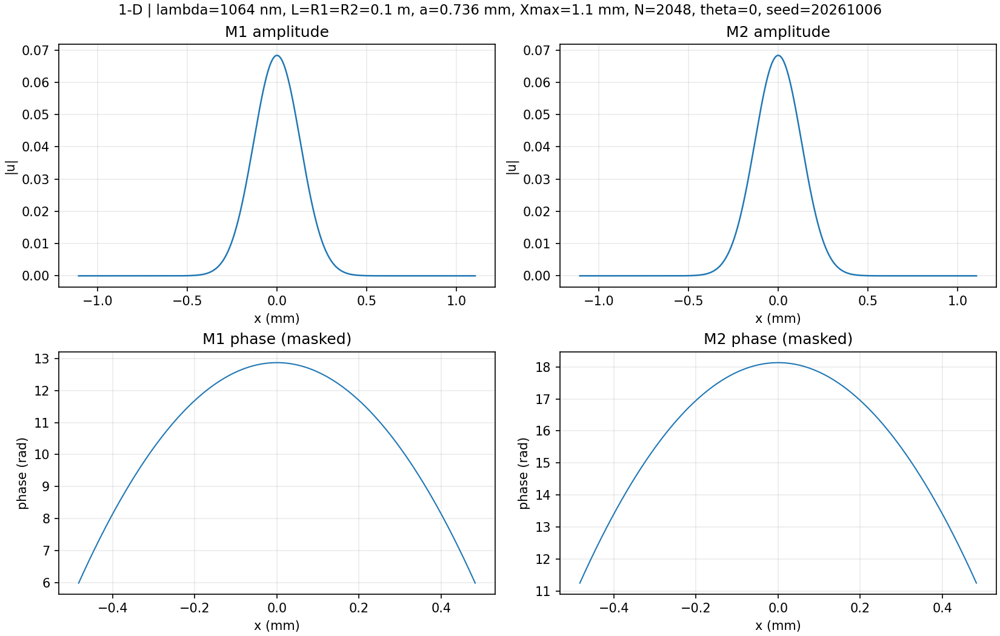

**图 1：两镜面上的一维振幅和相位，横坐标单位为 mm。**

上面两幅图都是中间高、两边低的钟形曲线，关于 $x=0$ 对称。两面镜子上的曲线宽度几乎一样，说明光斑没有发生偏移，也符合腔的对称结构。曲线到达孔径边缘之前已经很小，因此孔径对这个光斑的截断较弱。

下面的相位曲线呈开口向下的抛物线，与前文的二次相位一致：

$$
\phi(x)\simeq\phi_0-\frac{kx^2}{2L}.
$$

两面镜子的相位读数不同，是因为传播会带来整体相位变化，但曲线的形状基本相同。图中没有画出振幅低于峰值 $10^{-3}$ 的区域，避免很弱的场影响相位的观察。

### 3. 与理论结果比较

共焦腔基模的振幅近似为高斯分布[1]，镜面处的理论半径为

$$
 w_m=\sqrt{\frac{\lambda L}{\pi}}
 \simeq0.184\,\mathrm{mm}.
$$

在距离中心 $w_m$ 的位置，振幅降为中心的 $1/e$，光强降为中心的 $1/e^2$。

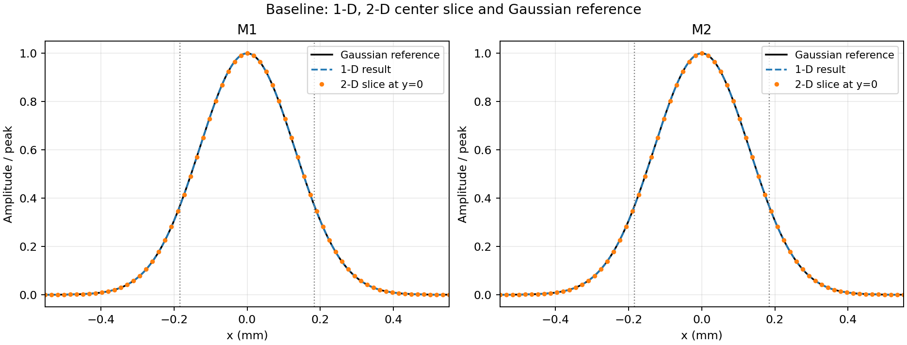

**图 2：一维结果、二维中心截面与理论振幅的比较，各曲线均除以自身峰值。**

黑实线是理论高斯曲线，虚线是一维结果，散点是二维结果在 $y=0$ 处的截面。三者基本重合，说明计算得到的光斑形状和宽度与理论相符。

程序得到两面镜子的光斑半径都约为 $0.184\,\mathrm{mm}$。同时比较振幅和相位后，数值场与理论场的重叠也接近 1，说明两者不仅振幅相似，相位分布也基本一致。

### 4. 收敛结果

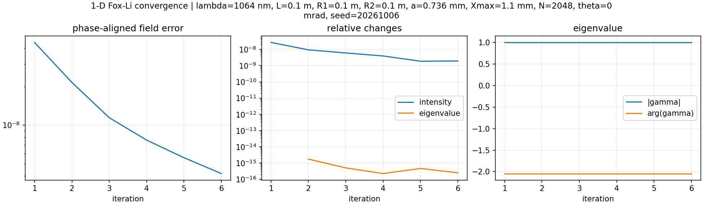

**图 3：一维迭代的场误差、光强与本征值变化。**

左图的场误差逐渐减小，第 6 轮约为 $4.17\times10^{-9}$。中图的光强变化和本征值变化也低于设定阈值，第 2 至第 6 轮连续满足条件，因此程序在第 6 轮停止。右图的本征值基本不变，说明往返后的振幅保留率和整体相位已经稳定。

一维往返本征值为

$$
\gamma_{\mathrm{1D}}\simeq-0.455043-0.890470i,
\qquad |\gamma_{\mathrm{1D}}|\simeq1.
$$

这表示光场往返后形状基本不变，只多了整体相位，振幅几乎没有衰减。这里收敛较快，是因为初场已经接近理论基模，并不说明任意初场都能在 6 轮内收敛。

本节数据见 [1D 结果](results/runs/20261008T100204Z/baseline/1d/summary.json) 和 [迭代记录](results/runs/20261008T100204Z/baseline/1d/history.csv)。

## 2D仿真及其分析

### 1. 振幅和相位分布

二维仿真采用 $512\times512$ 网格，采样间距约为 $4.313\,\mathrm{\mu m}$，其他物理参数与一维相同。程序在 $x$、$y$ 方向取相同的孔径半宽，因此这里使用的是方形孔径。

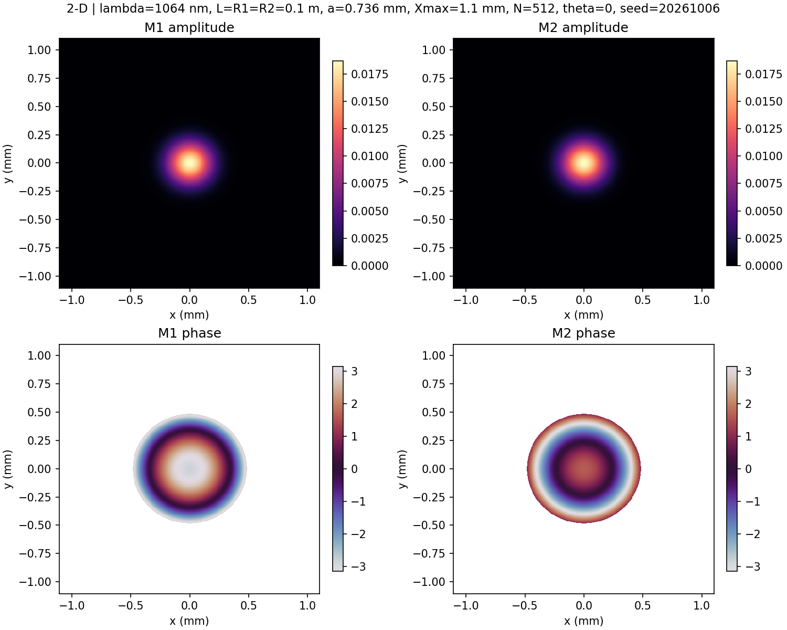

**图 4：二维振幅和相位分布，横纵坐标单位为 mm，相位单位为 rad。**

上排的亮斑位于中心，接近圆形，颜色从中心向外逐渐变暗。两面镜子的亮斑大小基本相同，没有明显的多瓣结构。这与一维的钟形曲线对应，也符合高斯基模的特点[1]。

虽然孔径是方形，光斑仍接近圆形。这是因为两个方向的聚焦作用相同，而且光斑比孔径小，边缘对它的影响较弱。

下排是相位图。不同颜色表示不同相位，同心圆环说明相位主要随离中心的距离变化。相位只显示在 $[-\pi,\pi]$ 内，超过这个范围就会按 $2\pi$ 折回，所以出现了彩色圆环。它们不是光强亮环，也不代表出现了多个模式。外围白色部分是低振幅区域，没有显示相位。

### 2. 收敛与本征值

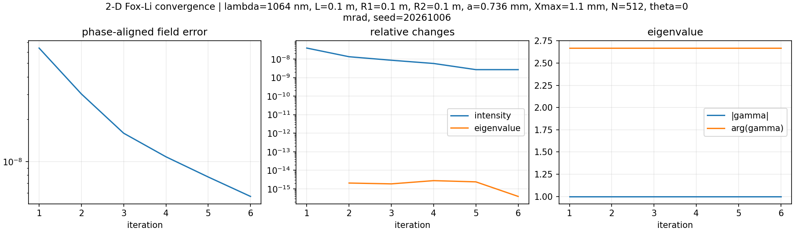

**图 5：二维迭代收敛曲线。**

二维计算同样在第 6 轮收敛，最终场误差约为 $5.65\times10^{-9}$，光强变化约为 $2.66\times10^{-9}$。本征值变化也满足要求，与一维结果一致。

| 指标 | 1D | 2D |
|---|---:|---:|
| 迭代次数 | 6 | 6 |
| 光斑半径 / mm | 0.184 | 0.184（两个方向相同） |
| 与理论基模的重叠 | 接近 1 | 接近 1 |
| 往返本征值 | $-0.455043-0.890470i$ | $-0.890470+0.455043i$ |
| 往返损耗 | 约为 0 | 约为 $1.11\times10^{-15}$ |

一维与二维的本征值相位不同，是因为二维多了一个横向方向，对应的衍射相位也不同。根据共焦基模的传播相位[1]，按本文的相位约定，无限孔径共焦基模的理论往返本征值为

$$
\gamma_{\mathrm{1D,th}}=e^{2ikL}e^{-i\pi/2},
\qquad
\gamma_{\mathrm{2D,th}}=e^{2ikL}e^{-i\pi},
$$

与计算结果相符。两种情况下的本征值模都接近 1，说明当前模式的往返衰减很小。

损耗接近零的主要原因是孔径较大，半宽约为光斑半径的 4 倍，光斑尾部到达边缘时已经很弱。模型中也没有加入镜面吸收、透射等损耗，因此不能把这个数值直接当作实际激光腔的损耗。$10^{-15}$ 量级的差异已接近浮点舍入误差。

直接 Fresnel 求和与 FFT 的复场相对差均小于 $10^{-8}$，已有网格和窗口检查中，基模的半径与重叠也基本不变，支持当前结果。相关数据见 [2D 结果](results/runs/20261008T100204Z/baseline/2d/summary.json)、[数值复核](results/runs/20261008T102004Z/verification.json) 和 [已有校验记录](results/runs/20261006T053807Z/validation_summary.json)。这些检查主要针对基模，大倾角情况还需要单独验证。

## 倾斜仿真及其分析

### 1. 倾斜设置

令 M2 绕 $x$ 轴转动，镜面高度会沿 $y$ 方向变化。参照球面镜谐振腔的相位处理[1]，结合前文的反射光程差推导，在反射算子中加入倾斜相位：

$$
Q_\theta(y)=\exp(i2ky\sin\theta).
$$

这里按程序约定取正号。倾斜改变了反射光的方向，因此可能使光斑偏移。扫描角度为 $0,0.1,0.3,0.5,1,2,3,5,6\,\mathrm{mrad}$，每个角度独立迭代。非零角度的初场根据几何关系作了偏移，用来加快计算。

本节采用已保存的 [完整倾斜扫描](results/runs/20261006T074916Z/tilt/scan.csv)，其参数与当前 YAML 相同，本次复算的小角度结果也与之吻合。

### 2. 随倾角变化的结果

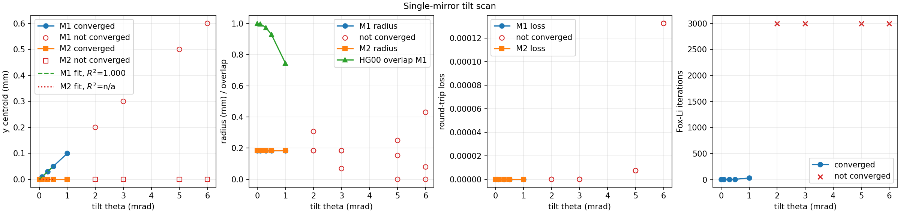

**图 6：质心、光斑半径与重叠、损耗、迭代次数随倾角的变化。红色空心点和红叉表示未收敛。**

第一幅图中，M1 的光斑中心随倾角增大向正 $y$ 方向移动，M2 的中心则基本不变。对 $0$ 至 $0.5\,\mathrm{mrad}$ 的收敛点拟合，斜率约为 $0.100\,\mathrm{mm/mrad}$，符合 $\bar y_{\mathrm{M1}}\simeq L\theta$。例如倾角为 $1\,\mathrm{mrad}$ 时，偏移约为 $0.1\,\mathrm{mm}$。

第二幅图中，小角度下两镜面的光斑半径基本不变，但与原来基模的重叠逐渐下降。这里半径的单位是 mm，重叠没有单位，两条曲线应分别看。

第三幅图中，收敛点的损耗都接近零。这说明在当前小角度范围内，光斑还没有被孔径明显截断。两镜面的曲线对应同一个往返损耗，所以基本重合。

第四幅图表明，倾角增大后计算更难收敛。$1\,\mathrm{mrad}$ 时需要 32 轮，而更大的几个角度都达到 3000 轮上限。

| 倾角 / mrad | M1 中心位置 / mm | M2 中心位置 / mm | 光斑半径 / mm | 与零倾角模式的重叠（M1） | 迭代次数 | 收敛 |
|---:|---:|---:|---:|---:|---:|:---:|
| 0 | 约 0 | 约 0 | 0.184 | 1.000 | 6 | 是 |
| 0.1 | 0.010 | 约 0 | 0.184 | 0.997 | 6 | 是 |
| 0.3 | 0.030 | 约 0 | 0.184 | 0.974 | 6 | 是 |
| 0.5 | 0.050 | 约 0 | 0.184 | 0.929 | 7 | 是 |
| 1 | 0.100 | 约 0 | 0.184 | 0.744 | 32 | 是 |
| 2 | — | — | — | — | 3000 | 否 |
| 3 | — | — | — | — | 3000 | 否 |
| 5 | — | — | — | — | 3000 | 否 |
| 6 | — | — | — | — | 3000 | 否 |

未收敛点只用于观察迭代过程，不作为稳定模式的定量结果。

### 3. 小角度下的光斑和相位

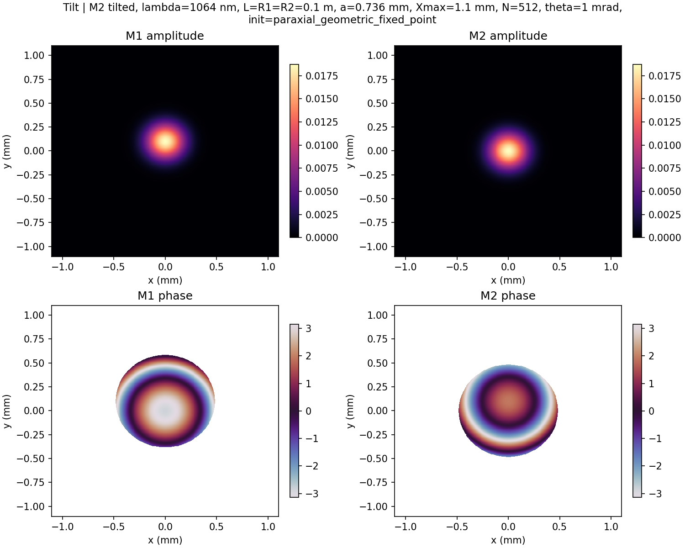

**图 7：M2 倾斜 $1\,\mathrm{mrad}$ 时的已收敛场分布。**

与未倾斜时相比，M1 的亮斑向上移动了约 $0.1\,\mathrm{mm}$，但仍接近圆形；M2 的亮斑基本留在原点。由于镜面绕 $x$ 轴转动，变化主要发生在 $y$ 方向。

M1 的光斑不再关于原光轴对称，但关于自己的新中心仍近似对称，所以小角度下主要是光斑平移，形状变化不明显。M2 的光斑虽然没明显移动，下排相位图却发生了变化，说明波前也受到了倾斜影响。

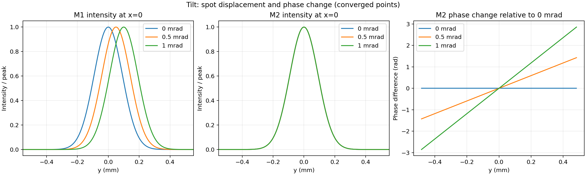

**图 8：$0,0.5,1\,\mathrm{mrad}$ 的光强截面和 M2 相位差。光强按各自峰值归一化，相位差去掉了整体常数。**

左图更清楚地显示，M1 的峰值位置依次为 $0,0.05,0.10\,\mathrm{mm}$，宽度几乎不变。中图三条曲线基本重合，说明 M2 的光强分布变化很小。右图中相位差近似为直线，而且倾角加倍时斜率也约加倍，说明倾角越大，波前倾斜越明显。

这种两镜面偏移不同的结果，可以结合球面镜腔轴的几何关系[1]理解：$R=L$ 时，M2 的曲率中心位于 M1 顶点附近，M2 倾斜后，曲率中心横移约 $L\theta$，腔轴也随之改变，因此 M1 处的光斑发生偏移，而 M2 处仍接近原点。

重叠下降不等于光功率损失。例如 $1\,\mathrm{mrad}$ 时重叠约为 0.744，但损耗仍很小，主要是光斑位置和相位与原模式不同。图中也没有明显的多瓣结构，本次没有进一步计算各阶模式的比例，因此不能仅凭重叠下降就判断激发了哪一个高阶模。

### 4. 大角度结果与未收敛情况

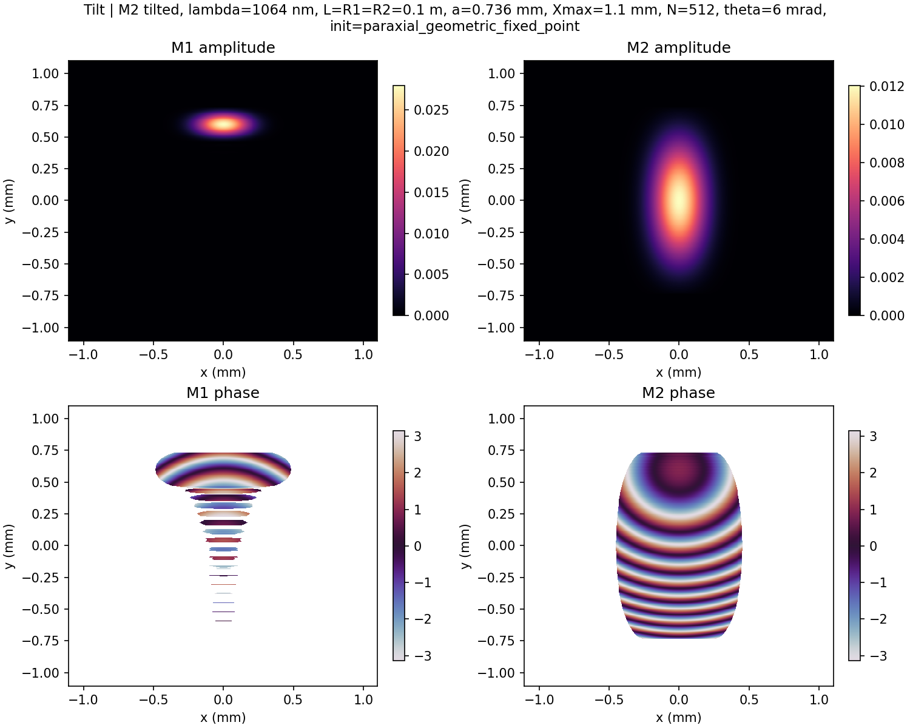

**图 9：$6\,\mathrm{mrad}$ 时第 3000 轮的场分布，尚未收敛。**

M1 的亮斑移到约 $y=0.6\,\mathrm{mm}$，沿 $y$ 方向变窄；M2 的亮斑则沿 $y$ 拉长，已经与小角度时有明显区别。此时 M1 光斑中心距孔径边缘只有约 $0.136\,\mathrm{mm}$，小于原光斑半径，孔径截断可能使场分布发生变化。

下排相位条纹变密，说明相位变化更快。但条纹数量不能直接当作模式阶数，白色部分还受到低振幅屏蔽的影响。由于迭代尚未收敛，这张图只能说明第 3000 轮时的场形，不能当作最终稳定模式。

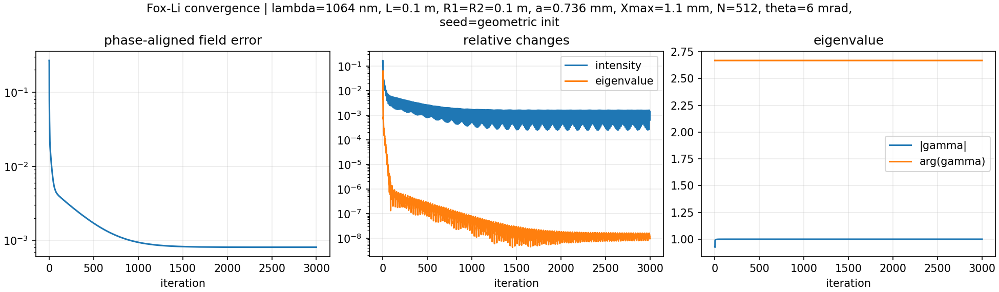

**图 10：$6\,\mathrm{mrad}$ 时的迭代变化。**

左图的误差先快速下降，后来停在约 $10^{-3}$ 量级。中图的光强变化也一直存在起伏，最终约为 $1.43\times10^{-3}$，高于 $10^{-7}$ 的阈值。虽然右图的本征值看起来基本不变，光场却还没有稳定，因此不能判断为收敛。

共焦腔存在模式简并的特点[1]；从幂法来看，当两个主要本征值的模很接近时，迭代会变慢[3]。这可能是本次慢收敛的原因之一，但还需要进一步验证。未收敛也不代表腔内一定不存在稳定模式，后续需要检查网格、初场和迭代方法。

目前可以确定：小角度倾斜主要使光斑偏移并改变相位，光斑半径变化不大；大角度下出现明显场型变化，但本次计算还没有得到可靠的稳定模式结果。

## 5. 参考文献

[1] Kogelnik, H.; Li, T. Laser Beams and Resonators[J]. *Applied Optics*, 1966, **5**(10)，起始页 1550. DOI：[10.1364/AO.5.001550](https://doi.org/10.1364/AO.5.001550).

[2] Johnson, M. M. Direct Application of the Fast Fourier Transform to Open Resonator Calculations[J]. *Applied Optics*, 1974, **13**(10)，起始页 2326. DOI：[10.1364/AO.13.002326](https://doi.org/10.1364/AO.13.002326).

[3] Saad, Y. *Numerical Methods for Large Eigenvalue Problems*[M]. 2nd ed. Philadelphia: SIAM, 2011. [作者公开全文](https://www-users.cse.umn.edu/~saad/eig_book_2ndEd.pdf).

## 6. AI 辅助记录
### 个人工作
我在这次大作业中主要完成前面部分的建模，AI建模出现以下问题：1. 忽略曲率带来的影响 2. 计算曲率带来的光程差的时候正负有误 3. 方向总是喜欢用矩阵和q参数来计算。其次我还主要完成调参任务，1D的建模分割网格数如果太小，不满足奈奎斯特采样定律，无法说明迭代成功，如果把网格增加的太大，会导致迭代时间过长，或者迭代次数增加1-2次才能收敛。反射镜的曲率越小，相位变化也就越小，聚焦越明显。孔径截断主要会影响γ的模，如果截断过大γ的模会变小。

### AI辅助
我使用的是codex 6.1sol high ubuntu24.04环境进行开发，主要是完成代码编写，公式推导和算法实现，例如FFT加速的代码和离散化网格的算法实现